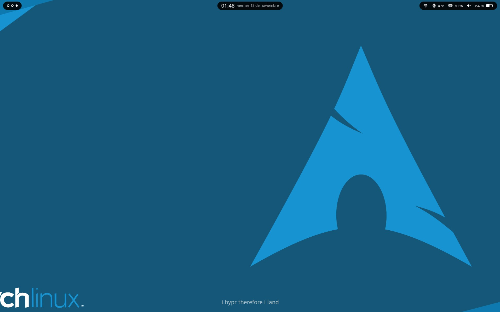

# hidebar

A minimal status overlay for **Hyprland**, written in Rust.

It is not a bar: it reserves no screen space, never takes the cursor (clicks pass through it) and only shows up
when you call it with a keybinding or when something relevant happens (you switch workspace, the network drops,
you plug in the charger…). The rest of the time nothing is drawn.




> [!WARNING]
> **This project is 100% vibe coded.** All of the code, icons and documentation were written by an AI agent
> (Claude) following natural-language instructions; no human wrote or reviewed the code line by line. It works on
> my machine and I use it daily, but take it for what it is: a personal experiment, with no warranty, no support and
> no stability promises. Read it before you run it.

## What it shows

Each module is drawn in its own semi-transparent black pill near the top edge of the screen.

| Module       | Where             | Content                                    | Shows up on its own when…                   |
|--------------|-------------------|--------------------------------------------|---------------------------------------------|
| `workspaces` | top left          | one dot per workspace; the active one filled | you switch workspace (1.5 s)              |
| `clock`      | top center        | time and date                              | —                                           |
| `status`     | top right         | network · cpu · ram · mute · battery       | the network changes, you mute/unmute, or you plug/unplug the charger (3 s) |

There is also an **indicator** in the top-right corner: a dot that pulses while the battery is low (≤ 25%, white;
≤ 10%, orange-red) and discharging. It hides while `status` is visible, since the battery pulses there too.

### `status` in detail

- **Network:** white wifi icon with internet access; orange with a local network but no way out; crossed out in
  orange-red with no default route. Checks `/proc/net/route` every 5 s and, if there is a route, tries a TCP
  connection to `1.1.1.1:443` (Cloudflare) every 30 s, without sending any data.
- **CPU and RAM:** usage percentage read from `/proc/stat` and `/proc/meminfo` every 3 s.
- **Mute:** crossed-out speaker only when the default audio output is muted or at 0%. Uses `pactl` (PipeWire or
  PulseAudio) and updates instantly through `pactl subscribe`.
- **Battery:** `/sys/class/power_supply/BAT*` every 10 s. White normally, pulsing when low, pulsing orange-red when
  critical, yellow while charging. Omitted when there is no battery.

### Calendar

`hidebar toggle clock` opens the current month under the clock, with today highlighted. `‹` `›` or the ←/→ arrow
keys change month; clicking the title or pressing `Home` goes back to the current month. Close it with `Esc`,
another `toggle clock`, or by clicking another window. It is the only part of the overlay that takes cursor and
keyboard input.

The interface (dates, CLI messages) is in Spanish.

## Requirements

- Hyprland (uses `wlr-layer-shell` and Hyprland's IPC for workspaces).
- Rust 1.88 or later (2024 edition).
- Optional: `pactl` for the mute indicator.
- Vulkan drivers for your GPU (e.g. `vulkan-radeon`, `vulkan-intel`, `nvidia-utils`). The daemon uses Vulkan by
  default, which keeps memory low (~120 MB RSS instead of ~275 MB when GL/EGL loads every installed driver).
  Set `WGPU_BACKEND=gl` to override it.

## Installation

```sh
git clone https://github.com/darilrt/hidebar-vc.git hidebar
cd hidebar
cargo install --path . --locked --root ~/.local
```

- Builds in release mode and puts the binary at `~/.local/bin/hidebar`.
- `--locked` is **required**: it uses the exact versions in `Cargo.lock`. Without it, cargo picks a newer
  `winit-core` that one dependency (`iced_exdevtools`) fails to build against.
- `--root ~/.local` is optional; without it the binary goes to `~/.cargo/bin`.

To update, run the same command again and restart the daemon. To uninstall:
`cargo uninstall hidebar --root ~/.local`.

## Usage

```text
hidebar daemon             start the daemon
hidebar show <module>      show the module for a few seconds
hidebar toggle <module>    depends on the module:
                             workspaces, status → pin / unpin (stays visible until the next toggle)
                             clock              → open / close the calendar
hidebar show all           all three modules for a few seconds
hidebar toggle all         if anything is pinned, unpin everything; otherwise pin all three
```

A pinned module never hides on its own and is not affected by automatic appearances.

The client talks to the daemon over a Unix socket at `$XDG_RUNTIME_DIR/hidebar.sock` and exits immediately. If the
daemon is not running, it says so and exits with an error.

## Hyprland configuration

In `~/.config/hypr/hyprland.conf`:

```ini
# Full path: Hyprland's PATH may not include ~/.local/bin or ~/.cargo/bin.
$hidebar = ~/.local/bin/hidebar

exec-once = $hidebar daemon

# Ctrl+Shift = peek; Ctrl+Shift+Alt = toggle.
bind = CTRL SHIFT, T, exec, $hidebar show clock
bind = CTRL SHIFT ALT, T, exec, $hidebar toggle clock         # calendar
bind = CTRL SHIFT, B, exec, $hidebar show status
bind = CTRL SHIFT ALT, B, exec, $hidebar toggle status        # pin network/cpu/ram/battery
bind = CTRL SHIFT, W, exec, $hidebar show workspaces          # optional: they appear on their own when switching
bind = CTRL SHIFT ALT, W, exec, $hidebar toggle workspaces
bind = CTRL SHIFT, A, exec, $hidebar show all
bind = CTRL SHIFT ALT, A, exec, $hidebar toggle all
```

To apply without logging out: `hyprctl reload` and, the first time, start the daemon from Hyprland (so it does not
depend on your terminal; `exec-once` only runs at login):

```sh
hyprctl dispatch exec ~/.local/bin/hidebar daemon
```

Note: a Hyprland `bind` takes priority over applications. With these bindings, `Ctrl+Shift+T`, `W`, `B` and `A` no
longer reach your browser (reopen tab, close window, bookmarks bar, add-ons). If you use them, pick other keys.

Restart the daemon after updating the binary:

```sh
pkill -f 'hidebar daemon'; hyprctl dispatch exec ~/.local/bin/hidebar daemon
```

## Development

```sh
cargo fmt --check
cargo clippy --all-targets -- -D warnings
cargo test
cargo test -- --ignored   # uses real Hyprland, battery, /proc, audio and network (includes a TCP connection to 1.1.1.1)
```

Useful environment variables:

- `HIDEBAR_SOCKET`: a different socket path, to run a development daemon next to your usual one (keep it short;
  Unix socket paths are limited to ~100 characters). Set it for the client too:

  ```sh
  export HIDEBAR_SOCKET=$XDG_RUNTIME_DIR/hidebar-dev.sock
  ./target/debug/hidebar daemon &
  ./target/debug/hidebar show all
  ```

- `HIDEBAR_BATTERY_PATH`: a directory with `capacity` (e.g. `8`) and `status` (e.g. `Discharging`) files, to
  simulate battery levels without waiting for it to drain.
- `WGPU_BACKEND`: graphics backend for wgpu. The daemon sets it to `vulkan` when it is unset; any explicit value
  (e.g. `gl`) is respected.

Layout:

```text
src/main.rs          CLI: daemon and client
src/ipc.rs           commands and Unix socket
src/event.rs         events emitted by the sources
src/hyprland.rs      workspaces (Hyprland IPC)
src/battery.rs       battery
src/system.rs        CPU and RAM
src/network.rs       network
src/audio.rs         mute (pactl)
src/app.rs           daemon state and surfaces
src/app/view.rs      drawing: pills, indicator, calendar
src/app/calendar.rs  Spanish dates and month grid
assets/icons/        custom SVG icons, embedded in the binary
```

## License

[MIT](LICENSE).
